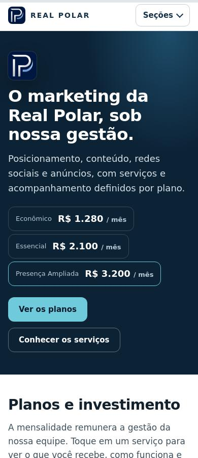
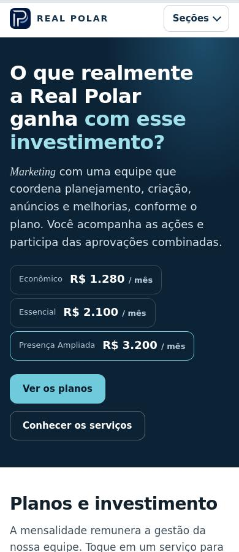
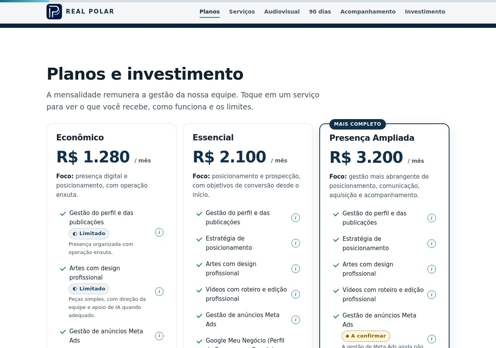
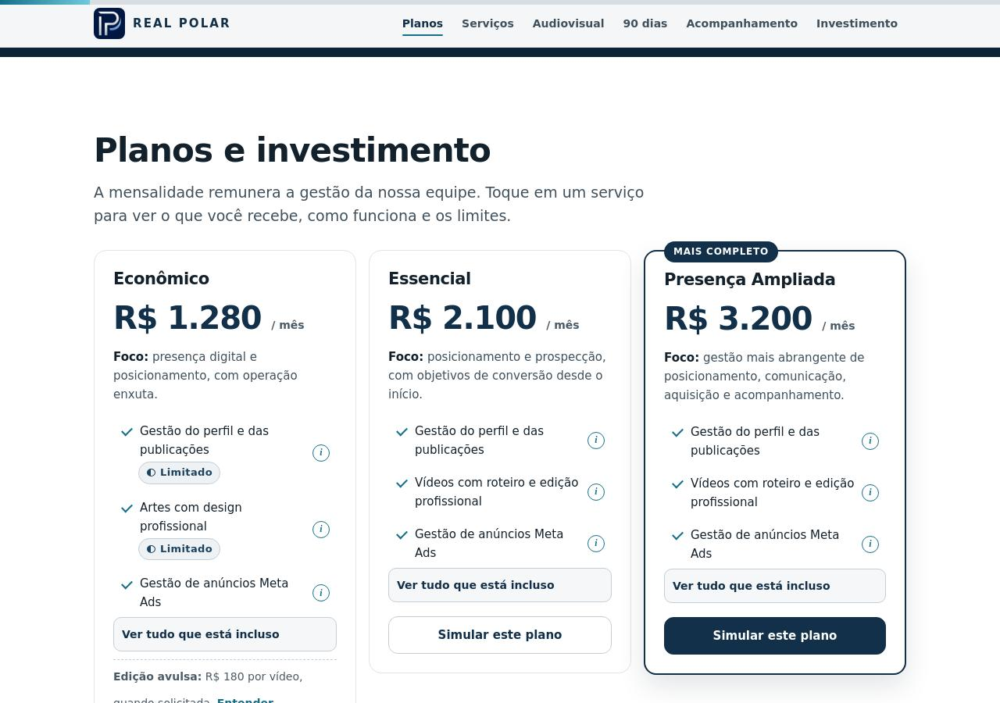

# REAL POLAR — entrega V7 + V8

Data: 02/11/2026, horário do responsável. Repositório: `caio090/REALPOLAR`.
Branch: `refinamento/proposta-v8`. Base: `ec052835b081332112860e9fba22157eefc15d16` (merge PR #4).
Commit da interface: `4b79e080e0f9805ede25aa2480af49432524c193`. O commit posterior contém somente evidências e documentação; seu SHA final é informado na entrega e no PR #5.

## Fontes e produção conferidas

V8 lido integralmente como adendo prioritário ao V7. Lidos AGENTS, estado, auditoria, README, CLAUDE e código. Diretório inicialmente limpo, `origin/main` atualizado por fetch; nenhum trabalho alheio sobrescrito. PR #4 está merged, #3 closed, #1/#2 merged.

Antes da edição, HTML de `https://realpolar-proposta.vercel.app/` e `index.html` tiveram SHA-256 idêntico: `af84a8d1824fa88697a3d862eb6cfc094aa350b90f0961cf042fe4caeaf6f456`. Conector Vercel confirmou `READY`, projeto `realpolar-proposta`, branch `main`, SHA da base e alias oficial. Status GitHub da base: sucesso de `Vercel – realpolar-proposta`, deployment `66yFK16MTZdhBpirRFadQMVSieJQ`. Existe também check do projeto `realpolar`; nenhum projeto foi criado, removido ou reconfigurado. A igualdade de arquivo comprova o conteúdo servido, não identifica sozinha todo o ambiente remoto.

Em produção: `/` 200; `/prototipo/`, `/AGENTS.md`, `/CLAUDE.md`, `/README.md` e `/docs/ESTADO_DO_PROJETO.md` 404. `.vercelignore`, porta 5500, noindex, metadados e assets originais preservados. Nenhum contrato novo fornecido; confirmações comerciais do V8 têm precedência sobre registros antigos, sem inferir quantidade ou prazo.

## Auditoria e antes/depois

| Etapa | Antes confirmado | Depois e estado |
| --- | --- | --- |
| 1. Abertura | Logo grande; “O marketing da Real Polar, sob nossa gestão.” | Logo só no cabeçalho; “O que realmente a Real Polar ganha com esse investimento?”; destaque na frase final; Marketing em Georgia local. Implementado e testado |
| 2. Planos | Listas completas, longas | Três serviços de resumo, demais itens e exclusões sob expansão independente. Preço e CTA permanecem fora do painel. Implementado e testado |
| 3. Serviços | Filtro Todos; Ampliado já inicial | Todos removido, três planos preservados, default Ampliado mantido. Estados por plano e orçamento independentes. Implementado e testado |
| 4. Estados comerciais | Meta Ads A a confirmar; Google A previsto | Incluídos segundo V8, com mídia separada e detalhes do Google em contrato. Mensalidade e verba também corrigidas nos pop-ups. Implementado e testado |
| 5. 90 dias | Bloco técnico de conversão e focos repetidos | Três meses preservados + microfrase de avaliação/ajuste sem promessa. Implementado e testado |
| 6. Acompanhamento | Três controles de indicadores | Ações, desempenho disponível, aprovações e próximos ajustes; relatório mensal no Essencial e frequência pendente no Ampliado. Implementado e testado |
| 7. Final | Apenas duas perguntas no simulador | Resumo de três preços + custos separados + campanha + quatro perguntas + fechamento. Implementado e testado |

Fonte de serviços: tabela `#cmp`, com `data-st`, `data-plan-detail` e `data-rel`. Resumo de cartões usa IDs de serviços existentes; o restante e as exclusões vêm da mesma matriz, sem lista comercial paralela. “Previsto”, “A confirmar” e “Fora” continuam distintos. Resumos não tornam pendências contratadas. Estado de expansão fica em cada cartão e é conservado ao alternar o seletor mobile.

Ordem efetiva em desktop e celular: abertura → planos → serviços → audiovisual → 90 dias → acompanhamento → simulador → resumo/FAQ → fechamento.

## Testes e limites

Script reproduzível: [testes/v8.cjs](testes/v8.cjs), executado com Playwright/Chromium já instalado fora do repo; sem dependências novas. Resultados: **363 verificações aprovadas, zero falhas finais**, mais **648 combinações matemáticas** conferidas por fórmula independente. Cada largura percorre 18 itens × 3 planos × 4 abas: 1.944 estados de pop-up no conjunto de 9 larguras.

| Cobertura | Resultado |
| --- | --- |
| 320, 360, 375, 390, 430, 768, 1024, 1280 e 1440 px | Sem overflow inicial, cartões expandidos e pop-ups; console sem erros de JavaScript |
| Cartões e matriz | Serviços iguais aos da fonte, sem duplicação; Enter abre, Espaço recolhe; estado ARIA e painel oculto corretos |
| Filtro/pop-up | Não alteram orçamento; conteúdo distinto em cada plano; Escape devolve foco ao gatilho |
| Menu mobile | Abre e fecha por Escape |
| Paisagem 568×320 / 844×390 e viewport 720×450 | Sem overflow e pop-up alcançável |
| Fonte 125% / 200% | Sem overflow após corrigir mínimo intrínseco do FAQ |
| Movimento reduzido | Usado nas verificações; CSS global desativa transições/animações |
| Sem JavaScript | Matriz com 54 blocos de plano, preços e resumo acessíveis |
| Impressão | PDF gerado; resumo e cartões presentes; não equivale a prova em impressora física |
| Cópia e recibo | Totais iguais para os cenários abaixo; redação dos 90 dias, acompanhamento e campanha alinhada |
| Contraste da headline | Cor glacial existente sobre fundo marinho preservada; sem certificação completa de acessibilidade |

Primeira rodada: 354/355; falha reproduzível no FAQ a fonte 200%, corrigida com coluna `minmax(0,1fr)` e mínimo zero. Rodada seguinte: 355/355. Acrescentada verificação cruzada de Meta Ads em mensalidade/verba: 356/356. Acrescentados CTAs dos três planos, progresso de 0 a 100% e alternância mapa/comparativo: final 363/363. O teste antigo V5 contém expectativas obsoletas de headline, filtro e conteúdo; o script V8 valida o comportamento vigente e fica versionado.

| Cenário sem mídia/captação | Total conferido em UI e cópia |
| --- | ---: |
| Econômico, 0 / 1 / 2 / 3 vídeos | R$ 1.280 / 1.460 / 1.640 / 1.820 |
| Econômico, 10 / 50 vídeos | R$ 3.080 / 10.280 |
| Essencial, 50 vídeos residuais | R$ 2.100 |
| Ampliado, 50 vídeos residuais | R$ 3.200 |

A fórmula `calc()`, `FEE`, preço R$ 180 e persistência não foram alterados. A matriz de 648 cenários inclui verba 0/15/25/50, dias 0/15/30, diárias 0/1/2 e vídeos 0/1/2/3/10/50 nos três planos. Referência de diária de R$ 1.200 continua sujeita a cotação.

Não executados: Safari/iOS, Android físicos, Firefox, leitor de tela real, impressora física, avaliação por decisor não técnico ou certificação WCAG. O viewport 720×450 simula o espaço de zoom 200% de uma janela 1440×900; não equivale a testar o controle nativo de zoom ou aparelho físico.

## Evidências visuais

Capturas atuais de produção (antes) e da prévia V8 (depois): [capturas/v8/](capturas/v8/), 390 e 1280 px. Incluem abertura, planos, serviços, 90 dias, acompanhamento, investimento, fechamento, três cartões abertos e pop-up. A seção final adicional tem captura própria de resumo.






## Pendências e publicação

Continuam pendentes contrato, periodicidade dos relatórios do Ampliado, volumes de posts/vídeos, limites de edição/revisões, rebranding/arquivos finais, requisitos/prazo do painel, bônus e dados de contato/validade. Nenhum sistema foi construído por estar citado na oferta.

Sem merge e sem deploy de produção nesta tarefa. Alterações destinam-se a PR revisável e prévia técnica na rota `/`. PR, SHA final, URL e verificação remota constam no registro de entrega adicionado após os checks. A publicação exige revisão e autorização do responsável.

Arquivos de código: somente `index.html`. Documentação: `AGENTS.md`, `README.md`, `docs/ESTADO_DO_PROJETO.md`, `docs/AUDITORIA_DESIGN_REALPOLAR.md`, este relatório, teste e capturas. Sem alterações em assets, `.devcontainer`, `.vercelignore`, credenciais ou infraestrutura.

## Registro de entrega e prévia verificada

- PR: https://github.com/caio090/REALPOLAR/pull/5 (aberto, base main).
- Prévia imutável da interface: https://realpolar-proposta-683yp1ubz-caio21.vercel.app/ — rota `/`, projeto `realpolar-proposta`, deployment `dpl_ELSNyA7amyxCipaYEokXu3T9zEbZ`, READY, branch `refinamento/proposta-v8`, SHA `4b79e080e0f9805ede25aa2480af49432524c193`, conferidos pelo conector Vercel.
- Prévia de branch: https://realpolar-proposta-git-refinamento-proposta-v8-caio21.vercel.app/ (pode acompanhar commits documentais posteriores).
- Testes na URL remota: **363/363** e **648 combinações**, mesmos resultados locais. Evidências: `testes/resultados-v8.json` e `testes/resultados-v8-preview.json`.
- HTML remoto equivale ao `index.html`, com acréscimo apenas do script de feedback da Vercel. Sem alteração de código cliente para disponibilizar a prévia.
- Remoto: `/prototipo/`, `/AGENTS.md`, `/CLAUDE.md`, `/README.md` e `/docs/ESTADO_DO_PROJETO.md` retornaram **404**. Nenhuma segunda apresentação pública nessas rotas.
- Nenhum merge ou deploy de produção. O push de branch criou prévias automáticas nos projetos já conectados `realpolar-proposta` e `realpolar`; não houve criação nem reconfiguração desses projetos. A URL a revisar é a do projeto oficial acima.
- Evidência de execução local: servidor Python na porta 5500 usado nos testes. Processos temporários de QA podem encerrar ao fim da ferramenta; `.devcontainer` e seu comando automático não foram modificados.

Revisar o PR e a prévia antes de autorizar publicação. A V5 permanece no domínio oficial até autorização expressa.

## Lista de arquivos alterados em relação à base

```text
AGENTS.md
README.md
docs/AUDITORIA_DESIGN_REALPOLAR.md
docs/ESTADO_DO_PROJETO.md
docs/RELATORIO_V8.md
docs/capturas/v8/antes-acompanhamento-1280.jpg
docs/capturas/v8/antes-acompanhamento-390.jpg
docs/capturas/v8/antes-inicio-1280.jpg
docs/capturas/v8/antes-inicio-390.jpg
docs/capturas/v8/antes-investimento-1280.jpg
docs/capturas/v8/antes-investimento-390.jpg
docs/capturas/v8/antes-noventa-1280.jpg
docs/capturas/v8/antes-noventa-390.jpg
docs/capturas/v8/antes-plano-A-aberto-1280.jpg
docs/capturas/v8/antes-plano-A-aberto-390.jpg
docs/capturas/v8/antes-plano-E-aberto-1280.jpg
docs/capturas/v8/antes-plano-E-aberto-390.jpg
docs/capturas/v8/antes-plano-S-aberto-1280.jpg
docs/capturas/v8/antes-plano-S-aberto-390.jpg
docs/capturas/v8/antes-planos-1280.jpg
docs/capturas/v8/antes-planos-390.jpg
docs/capturas/v8/antes-popup-1280.jpg
docs/capturas/v8/antes-popup-390.jpg
docs/capturas/v8/antes-proximo-1280.jpg
docs/capturas/v8/antes-proximo-390.jpg
docs/capturas/v8/antes-servicos-1280.jpg
docs/capturas/v8/antes-servicos-390.jpg
docs/capturas/v8/depois-acompanhamento-1280.jpg
docs/capturas/v8/depois-acompanhamento-390.jpg
docs/capturas/v8/depois-inicio-1280.jpg
docs/capturas/v8/depois-inicio-390.jpg
docs/capturas/v8/depois-investimento-1280.jpg
docs/capturas/v8/depois-investimento-390.jpg
docs/capturas/v8/depois-noventa-1280.jpg
docs/capturas/v8/depois-noventa-390.jpg
docs/capturas/v8/depois-plano-A-aberto-1280.jpg
docs/capturas/v8/depois-plano-A-aberto-390.jpg
docs/capturas/v8/depois-plano-E-aberto-1280.jpg
docs/capturas/v8/depois-plano-E-aberto-390.jpg
docs/capturas/v8/depois-plano-S-aberto-1280.jpg
docs/capturas/v8/depois-plano-S-aberto-390.jpg
docs/capturas/v8/depois-planos-1280.jpg
docs/capturas/v8/depois-planos-390.jpg
docs/capturas/v8/depois-popup-1280.jpg
docs/capturas/v8/depois-popup-390.jpg
docs/capturas/v8/depois-proximo-1280.jpg
docs/capturas/v8/depois-proximo-390.jpg
docs/capturas/v8/depois-resumo-1280.jpg
docs/capturas/v8/depois-resumo-390.jpg
docs/capturas/v8/depois-servicos-1280.jpg
docs/capturas/v8/depois-servicos-390.jpg
docs/testes/resultados-v8.json
docs/testes/v8.cjs
index.html
docs/testes/resultados-v8-preview.json
```
